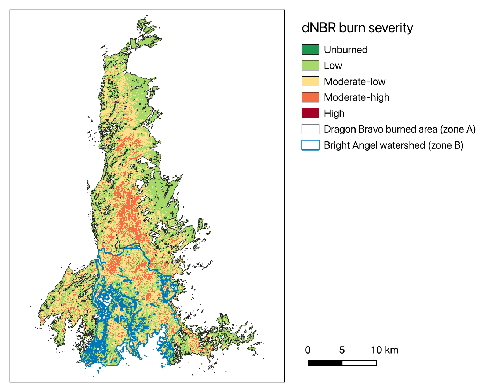
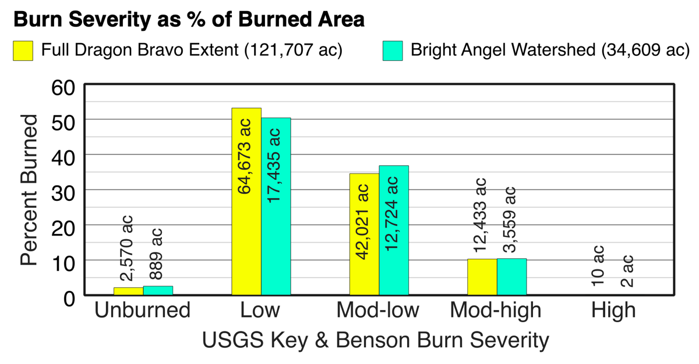
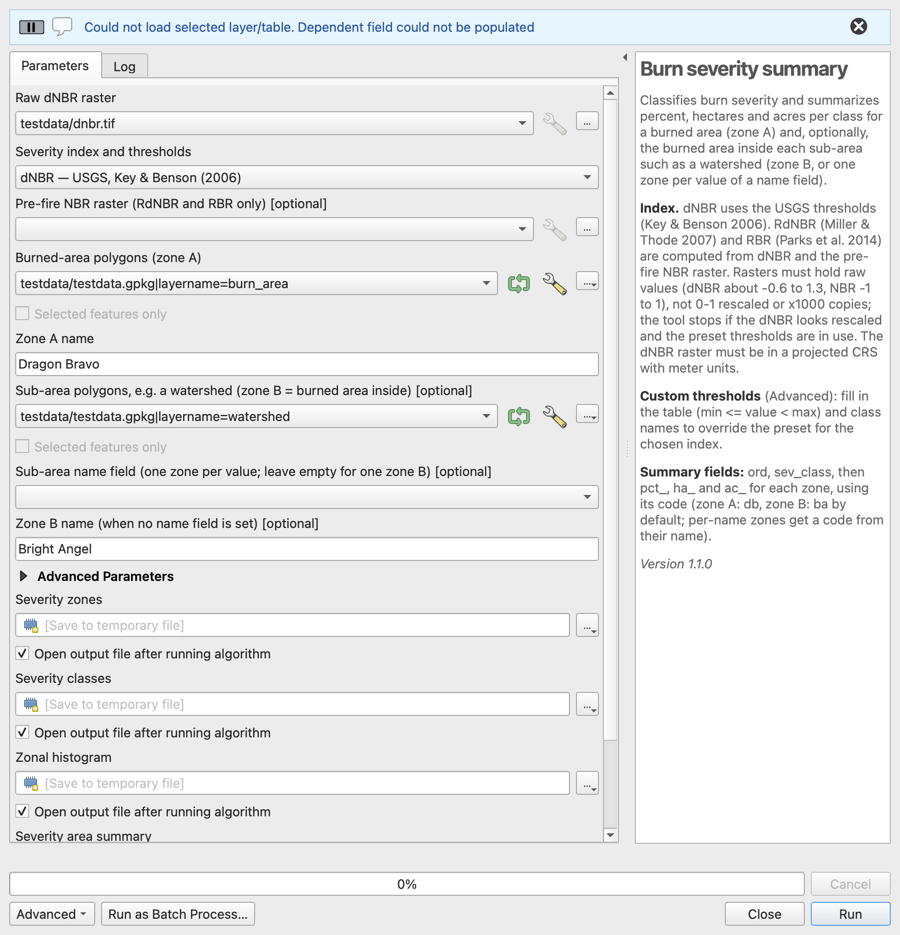

# QGIS Burn Severity Summary

A QGIS Processing tool that classifies burn severity from a dNBR raster (or RdNBR or RBR) and reports how much of a burned area, and of any sub-areas inside it, falls in each class, as percent, hectares and acres.

It was built to compare the 2025 Dragon Bravo Fire on the North Rim of Grand Canyon National Park with the Bright Angel Creek watershed inside it, and works for any fire and any set of sub-areas. One dialog replaces about a dozen manual steps (fix geometries, dissolve, intersect, tag, merge, reclassify, zonal histogram, field calculations and reshaping). The last output is a one-row-per-class table ready for a QGIS layout bar chart.





## Requirements

- QGIS 3.40 or later, including QGIS 4. Tested on QGIS 3.44 and 4.2.
- No extra plugins or Python packages. It uses only QGIS's built-in Processing tools.

## Installation

Choose one.

**As a plugin.** Build the zip with `python3 dev/build_plugin.py`, then in QGIS use *Plugins › Manage and Install Plugins › Install from ZIP* and pick `dist/qgis_burn_severity-<version>.zip`. The tool appears in the Processing Toolbox under **Fire Analysis › Burn severity summary** (algorithm id `fireanalysis:burnseveritysummary`).

**As a script.** In the Processing Toolbox, click the Python icon and choose **Add Script to Toolbox…**, then pick `burn_severity_summary.py`. The tool appears under **Scripts › Fire Analysis › Burn severity summary** (algorithm id `script:burnseveritysummary`). QGIS copies the file into your profile's `processing/scripts` folder, so add it again after downloading a new version.



## Quick start

Try it on the bundled [test data](testdata/README.md):

| Parameter | Value |
|---|---|
| Raw dNBR raster | `testdata/dnbr.tif` |
| Burned-area polygons | `testdata/testdata.gpkg`, layer `burn_area` |
| Sub-area polygons | `testdata/testdata.gpkg`, layer `watershed` |

Leave everything else at the defaults and click **Run**. The Bright Angel row of the zonal histogram should read 3,997 / 78,398 / 57,213 / 16,001 / 9 pixels.

## Fire analysis pipeline (plugin only, in development)

Version 2.0 grows the plugin into a fire analysis pipeline modeled on the MTBS [QGIS Fire Mapping Tool](https://www.mtbs.gov/qgis-fire-mapping-tool) (plan: [docs/DESIGN.md](docs/DESIGN.md)). Each step is a Processing algorithm, so the chain also runs in models, batch mode and `processing.run`:

1. **Imagery.** *Find HLS scenes* and *Fetch HLS NBR* get calibrated, cloud-masked NBR from NASA's [Harmonized Landsat Sentinel-2](https://hls.gsfc.nasa.gov/) (HLS v2.0) archive, for just the area of interest. *Prepare local scene NBR* does the same for Landsat or Sentinel-2 files you downloaded.
2. **Severity.** *Build dNBR* makes dNBR, RdNBR and RBR and measures the unburned offset. *Classify severity (MTBS classes)* writes the MTBS thematic classes.
3. **Summary.** *Burn severity summary* (above) reports percent, hectares and acres per class and zone.

Checked against 17 published MTBS fires: the imagery and calibration reproduce MTBS's classes (mean kappa 0.78); threshold estimates are a starting point (see *Validation against MTBS* below).

### One step: Burn severity from HLS

**Burn severity from HLS (whole pipeline)** (`fireanalysis:hlsburnseverity`, under **Fire Analysis › Pipeline**) runs everything below from a fire's burned-area polygons and dates, and writes the results to one folder.

| Parameter | Description |
|---|---|
| Burned-area polygons | The fire. Also the area of interest for the imagery. |
| Fire name | Zone name in the summary and the report. |
| Fire start, Fire end | Ignition and containment dates, for choosing the image pair. |
| Assessment | Initial (soon after the fire) or extended (next growing season). |
| Sub-area polygons, name field, name | Optional zones for the summary, as in *Burn severity summary*. |
| Estimate empty thresholds from; Low, Moderate, High threshold | As in *Classify severity*. |
| Pre-fire, Post-fire granule ids (Advanced) | Skip the pair search and use these. |
| Output folder | Where everything goes. |

Steps: *Suggest HLS image pairs* (rank 1; all candidates in `image_pairs.csv`), *Fetch HLS NBR* for both dates, *Build dNBR* (ring offset), *Classify severity*, *Burn severity summary* with the classification's thresholds. The folder holds `nbr_pre.tif`, `nbr_post.tif`, `reflectance_post.tif` (SWIR2/NIR/red, for checking the classes), `dnbr.tif`, `rdnbr.tif`, `rbr.tif`, `dnbr6.tif` with its MTBS style, `summary.gpkg` and `summary.csv`, zones and histogram, `dnbr6.png` (the classes with the burned-area outline), and `report.html` (with a bar chart and the map) and `report.json`: scenes, calibration, offset, thresholds and how they were chosen, the other estimate method's thresholds as a cross-check, every warning, and the summary. When the two threshold estimates disagree on the high threshold by more than 0.1, the report says so. The dNBR and the classes load into the project when it finishes.

With the granule ids given it takes under a minute for the Dragon Bravo test area; the pair search adds several minutes.

### Imagery

**Find HLS scenes** (`fireanalysis:findhlsscenes`) searches HLS L30 (Landsat 8/9) and S30 (Sentinel-2) granules over an area of interest and date range. It needs no login.

| Parameter | Description |
|---|---|
| Area of interest | Polygons, any CRS. |
| Start date, End date | Search window (UTC days). HLS starts in April 2013. |
| Sensors | L30, S30, or both. |
| Maximum scene cloud cover (%) | Drops granules above this tile-wide cloud cover. |
| Measure the clear share inside the AOI | Optional; reads each date's Fmask over the AOI only (needs the Earthdata login). |

Output: one footprint per granule with `granule`, `sensor`, `tile`, `date`, `doy`, `cloud` (scene %), `aoi_pct` (share of the AOI inside the footprint), and, when measured, `aoi_clear` and `aoi_data`: the share of the AOI that is clear (no cloud, adjacent cloud, shadow or snow) and that has data on that date, all tiles together. Tile-wide cloud cover says little about a small fire; `aoi_clear` is what matters.

**Suggest HLS image pairs** (`fireanalysis:suggesthlspairs`) chooses the dates for you, following the MTBS rules: post-fire dates soon after the fire (initial assessment, default up to 60 days after it ends) or in the next growing season (extended, June to September of the following year); pre-fire dates in the same season (default within 30 days of year) in the 1 to 2 years before. Both must be at least 95 % clear inside the area (default). It returns a ranked table (`rank`, `pre_date`, `pre_sensor`, `pre_clear`, `post_date`, `post_sensor`, `post_clear`, `doy_gap`, `years`, `pre_granules`, `post_granules`), ranked by the season gap in 5-day steps, then fewer years apart, then the clearer pair, then the earliest post-fire date. Copy `pre_granules` and `post_granules` into *Fetch HLS NBR*. It reads Fmask for every candidate date, so it takes a few minutes (about 7 minutes for the 100 or so candidate dates around Dragon Bravo).

**Fetch HLS NBR** (`fireanalysis:fetchhlsnbr`) reads only the AOI window of the chosen granules, mosaics their tiles, masks clouds and writes NBR.

| Parameter | Description |
|---|---|
| Area of interest | The same polygons. |
| HLS scenes | Output of *Find HLS scenes*, or a selection from it: all of one date and one sensor. Select every tile of that date that the AOI touches. |
| Or: granule ids | Instead of the layer: granule ids separated by spaces, such as `pre_granules` from *Suggest HLS image pairs*. |
| Buffer around the AOI (m) | Default 3,000, the margin MTBS uses to estimate the unburned dNBR offset. |
| Target CRS | Empty means the UTM zone of the AOI. |
| Fmask classes to mask | Default cloud, adjacent to cloud, cloud shadow, snow/ice and water. Cirrus and high aerosol (often smoke) are optional. |
| netrc file (Advanced) | Empty means `~/.netrc`. |

| Output | Description |
|---|---|
| NBR | Float32, raw units (−1 to 1), nodata −9999, 30 m. Metadata lists the granules and mask. |
| Reflectance (optional) | SWIR2 / NIR / red reflectance, for a false-color view of the burn. |
| Fmask (optional) | The Fmask window, unchanged. |

The grid is snapped to whole 30 m pixels in the target CRS, so a pre-fire and a post-fire run with the same AOI and CRS line up exactly.

**Prepare local scene NBR** (`fireanalysis:preparelocalnbr`) does the same for files you downloaded yourself: Landsat Collection 2 Level-2 (a scene or a US ARD tile; Landsat 4–9) or Sentinel-2 L2A. Use it for fires before 2013, for 20 m Sentinel-2, or when you already have the scenes. The output grid is the same one *Fetch HLS NBR* uses, so local and HLS NBR can be mixed.

| Parameter | Description |
|---|---|
| Scene folder | One acquisition. Subfolders are searched, so several tiles of one date (for example two Sentinel-2 tiles) are mosaicked. Landsat needs `*_SR_B*.TIF`; Sentinel-2 needs `*_B8A_20m.jp2` and `*_B12_20m.jp2`. Keep the metadata file (`*_MTL.txt`, the ARD `.json`, or `MTD_MSIL2A.xml`) and the quality band (`*_QA_PIXEL.TIF` or `*_SCL_20m.jp2`) with them. |
| Area of interest, Buffer, Target CRS | As for *Fetch HLS NBR*. |
| Pixel size (m) | Default 30. Sentinel-2 can use 20. Finer source pixels are averaged. |
| Classes to mask | From QA_PIXEL or SCL. Default cloud, dilated cloud (Landsat), cloud shadow, snow and water. |
| Sentinel-2 BOA offset (Advanced) | Default: from `MTD_MSIL2A.xml`, or −1000 when there is no metadata and the scene is from after 25 January 2022. Older scenes without metadata stop with a message: set the offset to 0 or −1000. |

Calibration: Landsat reflectance = DN × 0.0000275 − 0.2 (read from the metadata); Sentinel-2 reflectance = (DN + BOA_ADD_OFFSET) / 10,000, where the offset is −1000 for processing baseline 04.00 and later. Skipping either step is the error found in the Lab 6 dNBR. On the Lab 6 files, the local NBR matches HLS on the same grid: r = 0.999 for the Sentinel-2 pre-fire scene and 0.994 for the Landsat 9 post-fire tile.

### Severity

**Build dNBR** (`fireanalysis:builddnbr`, under **Fire Analysis › Severity**) turns the two NBRs into dNBR, RdNBR and RBR, and measures the dNBR offset: the median dNBR of unburned land, which is rarely exactly 0 because the two dates differ in phenology, moisture and sun angle.

| Parameter | Description |
|---|---|
| Pre-fire NBR, Post-fire NBR | Raw units (−1 to 1). The output uses the post-fire grid; the pre-fire NBR is resampled (bilinear) if its grid differs. x1000 rasters are refused. |
| Burned-area polygons | Used for the default offset: a ring outside them. |
| dNBR offset | None, median in a ring outside the burned area (default), median inside unburned-sample polygons, or a fixed value. |
| Unburned-sample polygons | For that method: areas of unburned vegetation like the burned vegetation (the MTBS practice). |
| Fixed offset | For that method, in raw dNBR units. |
| Ring gap, Ring width (Advanced) | Default 90 m and 2,000 m. |
| Subtract the offset from dNBR (Advanced) | Off by default: the USGS dNBR thresholds were set on uncorrected dNBR. |

| Output | Description |
|---|---|
| dNBR | Pre-fire NBR − post-fire NBR, Float32, nodata −9999. |
| RdNBR | (dNBR − offset) / √\|pre-fire NBR\| (Miller & Thode 2007; \|NBR\| floored at 0.001). |
| RBR | (dNBR − offset) / (pre-fire NBR + 1.001) (Parks et al. 2014). |
| Offset, standard deviation, pixel count | Numbers, also in the log and the raster metadata, for use in models. |

The log warns when the offset is beyond ±0.1 (a poorly matched pair), when the sample spreads widely (standard deviation above 0.05), and when more than 2 % of the sample has dNBR above 0.27, which means the "unburned" sample contains burned land, usually because the burned-area polygons are incomplete or clipped. The dNBR feeds *Burn severity summary* directly.

For Dragon Bravo (HLS S30 2024-09-13 and L30 2025-09-15, full Lab 6 perimeter), the ring offset is 0.026 with a standard deviation of 0.053.

**Classify severity (MTBS classes)** (`fireanalysis:classifyseverity`) writes the MTBS thematic classes (`dnbr6`) inside the burned area: 1 unburned to low, 2 low, 3 moderate, 4 high, 5 increased greenness, 6 non-mapping (no data), 0 outside. A class starts at its threshold (dNBR ≥ threshold); increased greenness is dNBR ≤ −0.150. A `.qml` file next to the raster gives it the MTBS colors when QGIS loads it.

| Parameter | Description |
|---|---|
| dNBR | Raw units, from *Build dNBR* (its offset is read from the metadata). |
| Pre-fire NBR | For the threshold estimates. |
| Burned-area polygons | The area to classify. |
| Assessment | Initial or extended. |
| Low, Moderate, High threshold | Raw dNBR. Empty means estimate; 9.999 switches a class off. |
| Estimate empty thresholds from | The median thresholds of MTBS wildfires within 150 km over the past 10 years (default; online; same assessment type when there are 5 or more), or this fire's own data: low = offset + 2 robust standard deviations of the offset sample, high = the dNBR value that best matches RdNBR ≥ 750 (initial) or 640 (extended) where the pre-fire NBR is at least 0.5, moderate midway. The radius and years are Advanced options. |

Thresholds are fire-specific choices by an analyst. The estimates are a starting point and are described, with how well they reproduce MTBS, under *Validation against MTBS*.

### Earthdata login

Reading HLS needs a free [NASA Earthdata](https://urs.earthdata.nasa.gov) account in `~/.netrc`, readable only by you (`chmod 600 ~/.netrc`):

```
machine urs.earthdata.nasa.gov login YOUR_USER password YOUR_PASSWORD
```

GDAL sends the login only to `urs.earthdata.nasa.gov` and keeps the session cookie in a private temporary folder. A plugin setting for credentials may replace the netrc later.

Fmask sometimes marks fresh burn scars as cloud shadow or water. The log reports how much of the area each class removed. If that share is large inside the fire, rerun without that class. In the Dragon Bravo test area, 0.64 % of the burned area (formerly vegetated, pre-fire NBR about 0.4) is flagged water only after the fire, slightly more in the higher severity classes; real water such as the Colorado River is the reason water stays masked by default.

### Validation against MTBS

`dev/mtbs_validation.py` runs the pipeline on published [MTBS](https://www.mtbs.gov) fires with MTBS's own pre- and post-fire dates and sensor (HLS L30 for Landsat 8/9 scenes, S30 for Sentinel-2), its perimeter and its thresholds, and compares the result with the MTBS `dnbr6` classes pixel by pixel. This isolates the imagery and calibration.

| Fire | State | Year | Sensors | Acres | Assessment | Agreement | Kappa | High, MTBS / ours |
|---|---|---|---|---|---|---|---|---|
| Bear Trap | NM | 2022 | L8 → L9 | 38,222 | Initial | 84.6 % | 0.730 | 5.10 / 5.56 % |
| Black | NM | 2022 | L8 → L9 | 328,399 | Initial | 84.1 % | 0.758 | 6.18 / 6.82 % |
| Cerro Pelado | NM | 2022 | L8 → L8 | 45,605 | Initial | 86.9 % | 0.723 | 2.10 / 2.58 % |
| Contreras | AZ | 2022 | L8 → L8 | 31,281 | Initial | 84.6 % | 0.747 | 4.63 / 5.09 % |
| Cooks Peak | NM | 2022 | L8 → L8 | 61,143 | Initial | 86.4 % | 0.782 | 13.29 / 13.95 % |
| Hermits Peak | NM | 2022 | L8 → L8 | 351,782 | Extended | 78.6 % | 0.711 | 15.75 / 16.75 % |
| Mitchell | NM | 2022 | L9 → L9 | 23,222 | Initial | 88.3 % | 0.750 | none |
| Pipeline | AZ | 2022 | S2A → S2A | 26,412 | Initial | 88.9 % | 0.798 | 11.25 / 11.96 % |
| Tonto Canyon | AZ | 2022 | S2B → S2A | 16,967 | Initial | 89.0 % | 0.818 | 0.88 / 1.13 % |
| Tunnel | AZ | 2022 | S2B → S2B | 17,641 | Initial | 85.6 % | 0.723 | 4.10 / 5.09 % |
| Divide | NM | 2023 | L8 → L9 | 26,656 | Initial | 90.4 % | 0.781 | 0.28 / 0.31 % |
| Pass | NM | 2023 | S2A → S2B | 66,128 | Initial | 90.7 % | 0.809 | none |
| Pilot | AZ | 2023 | S2B → S2A | 29,915 | Initial | 87.1 % | 0.757 | 5.73 / 5.72 % |
| Freeman | AZ | 2024 | S2A → S2B | 32,924 | Initial | 93.3 % | 0.864 | 1.48 / 1.79 % |
| Sand Stone | AZ | 2024 | S2B → S2B | 26,446 | Initial | 96.8 % | 0.808 | none |
| Siphon | AZ | 2024 | S2A → S2A | 15,001 | Initial | 95.2 % | 0.806 | none |
| Skeleton | AZ | 2024 | S2B → S2A | 22,745 | Initial | 98.1 % | 0.814 | none |

All 17 MTBS wildfires over 15,000 acres in Arizona, New Mexico, Colorado and Utah from 2022 to 2024 that the MTBS image service had published by October 2026 (Yellow Lake, Utah, 2024, an extended assessment, was not yet in it). Mean per-pixel agreement 88.7 %, mean kappa 0.775 (0.711 to 0.864); every fire agrees within one class on at least 99.8 % of its pixels, and the high-severity share is within 1 percentage point of MTBS's. Landsat and Sentinel-2 pairs do equally well. Our automatic ring offset differs from MTBS's analyst-sampled offset by a median of 0.009 (up to 0.047, for Divide).

The thresholds that best reproduce MTBS's classes on our dNBR are, on average, within 0.006 (low) and 0.012 (high) of MTBS's own, so our dNBR is on the MTBS scale. The remaining question is choosing thresholds without an analyst. `dev/threshold_study.py` scores the estimates against MTBS's choices on the same fires, leave-one-out:

| Thresholds | Mean kappa vs MTBS classes |
|---|---|
| MTBS's own (analyst) | 0.775 |
| Median of nearby MTBS fires, 150 km, 10 years (*Classify severity* default) | 0.56 |
| This fire's data: offset + 2 robust SD; RdNBR match in dense vegetation; midway | 0.49 |
| Key & Benson (2006) generic 0.10 / 0.27 / 0.66 | 0.48 |

So the imagery and calibration reproduce MTBS, while the automatic thresholds recover only part of the analyst's judgment. Review estimated thresholds before using the classes.

## Inputs

| Parameter | Description |
|---|---|
| **Raw dNBR raster** | Pre-fire NBR minus post-fire NBR, in raw units (about −0.6 to 1.3). It must be in a projected CRS with meter units. |
| **Severity index and thresholds** | **dNBR**, USGS thresholds (Key & Benson 2006, five classes; default); **RdNBR** (Miller & Thode 2007) or **RBR** (Parks et al. 2014), each four classes. See [Severity indices](#severity-indices). |
| **Pre-fire NBR raster** | Raw pre-fire NBR (−1 to 1). Required for RdNBR and RBR, ignored for dNBR. It may be on a different grid; it is resampled to the dNBR grid. |
| **Burned-area polygons (zone A)** | Polygons of the burned area. They are dissolved into one zone. |
| **Zone A name** | Label for zone A. Default *Dragon Bravo*. |
| **Sub-area polygons** | Optional. Any polygon layer, such as a watershed. Each sub-area zone is the part of zone A inside it. Leave empty to summarize zone A alone. |
| **Sub-area name field** | Optional. With a field set, each distinct value becomes its own zone, for example one per sub-watershed. Without one, all sub-area polygons together form one zone B. |
| **Zone B name** | Label for zone B when no name field is set. Default *Bright Angel*. |

Advanced:

| Parameter | Description |
|---|---|
| **Custom thresholds** | A reclassification table (Minimum, Maximum, Value; min ≤ value < max) that replaces the preset for the chosen index. Empty means use the preset. |
| **Custom class names** | Comma-separated names in table order. Empty means the preset names (or *Class 1*, *Class 2*… with a custom table). |
| **Summary field code for zone A / zone B** | Short codes used in the summary field names. Defaults `db` and `ba`. |

### Rescaled input is refused

The preset thresholds only make sense for raw index values. When they are in use, the tool stops if the dNBR raster's values all lie between 0 and 1 (a 0–1 rescaled copy) or reach beyond ±2 (a ×1000 copy), and if a pre-fire NBR lies outside −1 to 1. With custom thresholds the same checks only warn.

## Outputs

Each output can be a temporary layer or a saved file (GeoPackage recommended).

| Output | Contents |
|---|---|
| **Severity zones** | One polygon per zone, with a `zone` field. |
| **Severity classes** | Integer raster of class values; 0 is NoData. |
| **Zonal histogram** | The zones with pixel counts per class: `C_1`, `C_2`, … |
| **Severity area summary** | A table with no geometry and one row per class. This is the chart source. |

Summary table fields:

| Field | Meaning |
|---|---|
| `ord` | Sort order, 1 to the number of classes. |
| `sev_class` | Class name. |
| `pct_<code>` | Percent of the zone's classified pixels, one field per zone. |
| `ha_<code>` | Hectares. |
| `ac_<code>` | Acres, rounded to whole acres. |

`<code>` is `db` for zone A and `ba` for zone B unless changed under Advanced, which gives `pct_db`, `pct_ba`, `ha_db` and so on. Keeping the codes fixed means a saved layout chart keeps working when you rerun the tool with other zone names. When a name field creates one zone per value, each zone's code is the first six letters and digits of its name in lowercase (for example `Bright Angel West` → `bright`), with a number added if two would clash. Six characters keep every field name within the 10-character limit of shapefiles.

## Severity indices

| Index | Formula (raw units) | Classes and thresholds |
|---|---|---|
| dNBR | NBR<sub>pre</sub> − NBR<sub>post</sub> | Unburned < 0.10 ≤ Low < 0.27 ≤ Moderate-low < 0.44 ≤ Moderate-high < 0.66 ≤ High |
| RdNBR | dNBR / √\|NBR<sub>pre</sub>\| | Unchanged < 0.069 ≤ Low < 0.315 ≤ Moderate < 0.640 ≤ High |
| RBR | dNBR / (NBR<sub>pre</sub> + 1.001) | Unchanged < 0.035 ≤ Low < 0.130 ≤ Moderate < 0.298 ≤ High |

Published RdNBR and RBR thresholds are in ×1000 units (69, 315, 640 and 35, 130, 298). They are divided by 1000 here because the tool works in raw units. For RdNBR, \|NBR<sub>pre</sub>\| is floored at 0.001 so bare or sparse pixels can't divide by nearly zero. RdNBR and RBR adjust dNBR for how much vegetation there was before the fire, so they compare sparse and dense vegetation more fairly than dNBR does.

## Method

The tool runs these steps. The names are those in the Processing Toolbox, so the workflow can also be followed by hand.

### 1. Build the zones

1. **Fix Geometries** (`native:fixgeometries`) on the burned-area polygons, and on the sub-areas if given.
2. **Dissolve** (`native:dissolve`) the fixed burned area into one polygon: **zone A**.
3. **Dissolve** the sub-areas, by the name field if one is set.
4. **Intersection** (`native:intersection`) of the sub-areas with zone A, then **Dissolve** again: the **sub-area zones**, the burned area inside each sub-area.
5. **Field Calculator** (`native:fieldcalculator`) adds a text field `zone` to each zone layer: the zone A name, the zone B name, or the name field's value.
6. **Merge Vector Layers** (`native:mergevectorlayers`) combines the zones in the dNBR raster's CRS, and **Retain Fields** (`native:retainfields`) keeps only `zone`.

### 2. Classify severity

For RdNBR or RBR, **Raster calculator** (`native:modelerrastercalc`) first computes the index from dNBR and the pre-fire NBR on the dNBR grid.

**Reclassify by Table** (`native:reclassifybytable`) then classifies band 1 with the threshold table, using min ≤ value < max, NoData for values outside every range, output NoData 0 and an Int32 output. If the output has no CRS, the tool writes the dNBR's CRS into it.

### 3. Count pixels per class in each zone

**Zonal Histogram** (`native:zonalhistogram`) on the classified raster with the zones, column prefix `C_`. A pixel counts toward a zone when its center falls inside the polygon. A class with no pixels in any zone counts as 0.

### 4. Compute area and percent

For each class *i*, with the pixel area taken from the raster's cell size:

| Value | Formula |
|---|---|
| Hectares | `C_i × pixel area (ha)`. A 30 m pixel is 0.09 ha. |
| Acres | `round(hectares × 2.4710538)` |
| Percent of zone | `100 × C_i / (C_1 + … + C_n)` |

The results are written as one row per class, so a chart can use the class as its category axis.

## Example: Dragon Bravo Fire, 2025

dNBR from 30 m imagery, NAD83 / UTM 12N (EPSG:26912), USGS thresholds.

| Class | Dragon Bravo % | Dragon Bravo ac | Bright Angel % | Bright Angel ac |
|---|---|---|---|---|
| Unburned | 2.11 | 2,570 | 2.57 | 889 |
| Low | 53.14 | 64,673 | 50.38 | 17,435 |
| Moderate-low | 34.53 | 42,021 | 36.77 | 12,724 |
| Moderate-high | 10.22 | 12,433 | 10.28 | 3,559 |
| High | 0.01 | 10 | 0.01 | 2 |
| **Total** | **100** | **121,707** | **100** | **34,609** |

Totals from pixel counts are slightly below the polygon areas because of the pixel-center rule.

**This example's dNBR is miscalibrated.** It was later traced to two input errors: pre-fire Sentinel-2 NBR computed without the −1000 `BOA_ADD_OFFSET`, and post-fire Landsat 9 NBR computed from unscaled digital numbers. Rebuilt correctly from the same scenes, or fetched from HLS with the algorithms above, Dragon Bravo's burned area is about 2 / 17 / 26 / 28 / 27 % Unburned / Low / Moderate-low / Moderate-high / High instead of 0.01 % High. The table stays as the tool's test reference for the Lab 6 raster.

## Charting the results in a layout

The summary table plugs straight into a QGIS layout chart item (*Add Item › Add Chart*):

- **Chart type:** bar chart.
- **Source layer:** the summary table, with **Sort features** on, sorted by `ord`, ascending.
- **One series per zone:** X = `"sev_class"`, Y = `"pct_db"` for zone A, `"pct_ba"` for zone B, and so on.
- **Y axis:** percent of each zone's burned area.

Plotting percent puts zones of different sizes on the same scale. Use the `ac_` fields for bar labels to keep the absolute areas visible.

## Troubleshooting

| Symptom | Cause and fix |
|---|---|
| "…looks rescaled to 0-1" or "…looks scaled (for example x1000)" | The raster isn't in raw units. Use the raw dNBR or NBR. If it really is raw, enter thresholds under *Custom thresholds* to skip the check. |
| "dNBR raster must be in a CRS with meter units" | Reproject the dNBR to a projected CRS such as UTM with **Warp (Reproject)** first. |
| "…needs the pre-fire NBR raster" | RdNBR and RBR are computed from the pre-fire NBR. Add it, or choose dNBR. |
| "N classes in the threshold table but M class names" | Give one class name per table row, in the same order. |
| "No burned area inside: …" | Those sub-areas don't overlap the burned area and are left out of the summary. |
| "Invalid value for minimum" when typing a threshold | A pasted minus sign may be a typographic `−` rather than a hyphen `-`. Type it with the keyboard. |
| The tool still shows old behavior after an update | Reinstall the plugin, or add the script again, then refresh the Toolbox or restart QGIS. |

## Limitations

- **Generic thresholds.** None of the preset thresholds were calibrated for a particular fire. Field-validated products such as BAER Soil Burn Severity maps use fire-specific thresholds. Use custom thresholds when you have calibrated ones.
- **Calibration.** The tool trusts that its input dNBR was made from surface reflectance. Sentinel-2 L2A (processing baseline 04.00 and later, from January 2022) needs the −1000 offset before dividing by 10,000, and Landsat Collection 2 Level-2 needs DN × 0.0000275 − 0.2. Skipping either one changes every class. HLS input avoids both problems.
- **Sensor consistency.** Pre- and post-fire images from different sensors (for example Sentinel-2 and Landsat) can shift NBR values and with them every index. HLS harmonizes the two.
- **Pixel-center rule.** Zonal Histogram counts a pixel in a zone only if its center is inside, so small or narrow zones are approximated.

## Development

| Path | Purpose |
|---|---|
| `burn_severity_summary.py` | Burn severity summary, a single file that also installs as a script. |
| `fireanalysis/` | The pipeline package (plugin only): Earthdata login, STAC search, HLS, and the imagery algorithms. |
| `plugin/` | Plugin wrapper: provider, entry point, `metadata.txt`, icon. |
| `docs/DESIGN.md` | The pipeline plan, decisions and verified service details. |
| `dev/build_plugin.py` | Builds `dist/qgis_burn_severity-<version>.zip`. |
| `dev/smoke_test.py` | Runs every mode on `testdata/` and checks the counts, inside QGIS (Python Console) or headless. |
| `dev/pipeline_test.py` | Tests the offline pipeline algorithms (Build dNBR) on `testdata/`. |
| `dev/online_test.py` | Runs the whole chain against the live HLS archive, from search to summary table (needs a network and the Earthdata login). |
| `dev/run_headless.sh` | Runs a dev script with a QGIS app's bundled Python, for example `dev/run_headless.sh /Applications/QGIS.app` (smoke test) or `dev/run_headless.sh /Applications/QGIS.app online_test.py`. |
| `dev/make_testdata.py` | Rebuilds `testdata/` from the full Lab 6 data. |

Version history is in [CHANGELOG.md](CHANGELOG.md).

## References

- Key, C. H., & Benson, N. C. (2006). Landscape Assessment (LA). In *FIREMON: Fire Effects Monitoring and Inventory System* (Gen. Tech. Rep. RMRS-GTR-164-CD). USDA Forest Service, Rocky Mountain Research Station.
- Miller, J. D., & Thode, A. E. (2007). Quantifying burn severity in a heterogeneous landscape with a relative version of the delta Normalized Burn Ratio (dNBR). *Remote Sensing of Environment*, 109(1), 66–80.
- Parks, S. A., Dillon, G. K., & Miller, C. (2014). A new metric for quantifying burn severity: The relativized burn ratio. *Remote Sensing*, 6(3), 1827–1844.

## License

MIT. See [LICENSE](LICENSE).

## Author

Stephen Conklin
